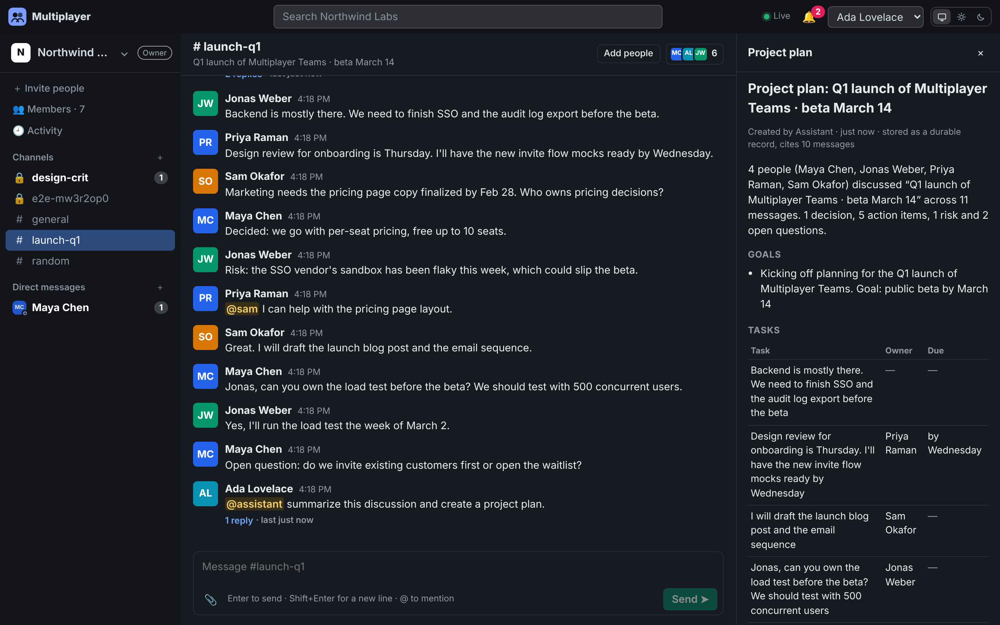
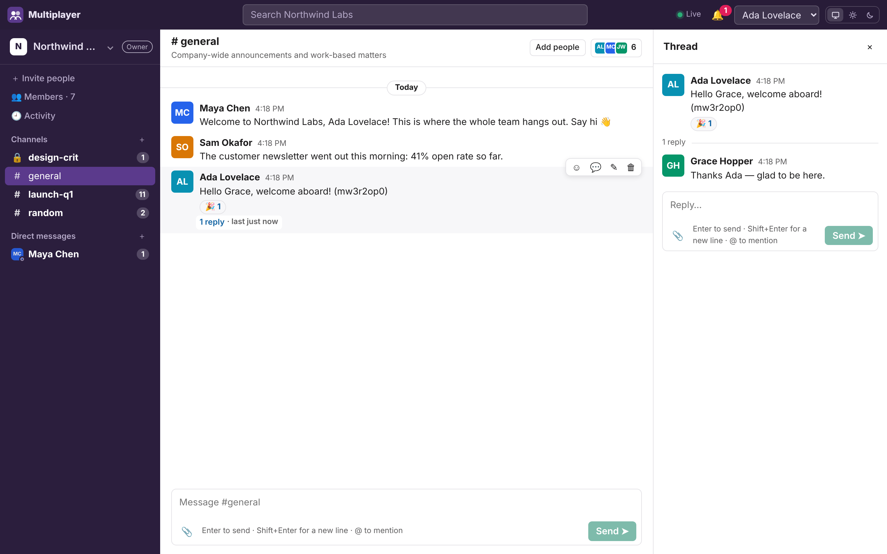
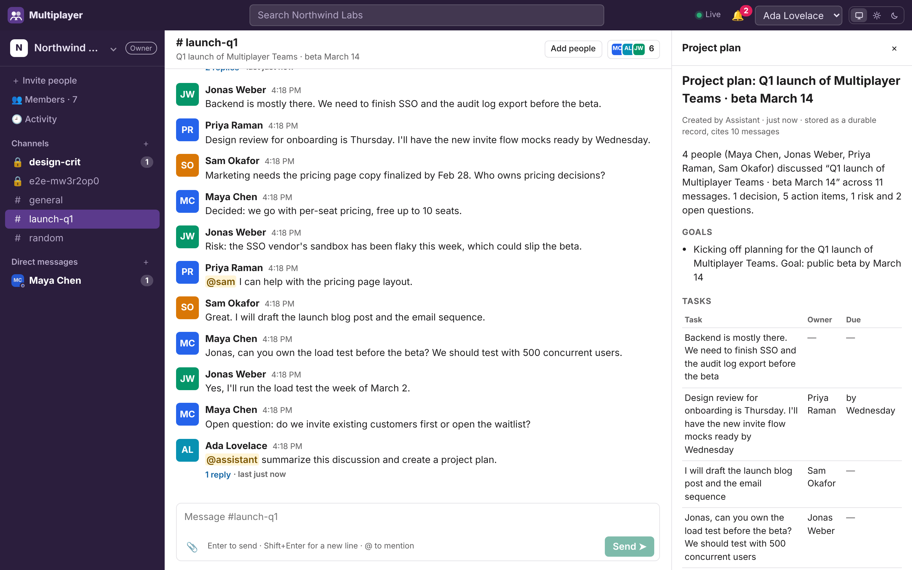
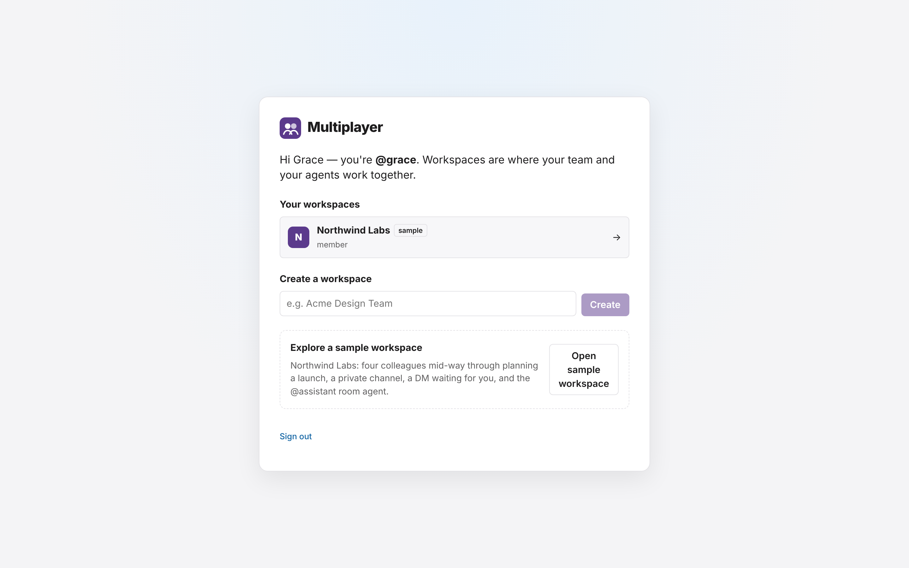
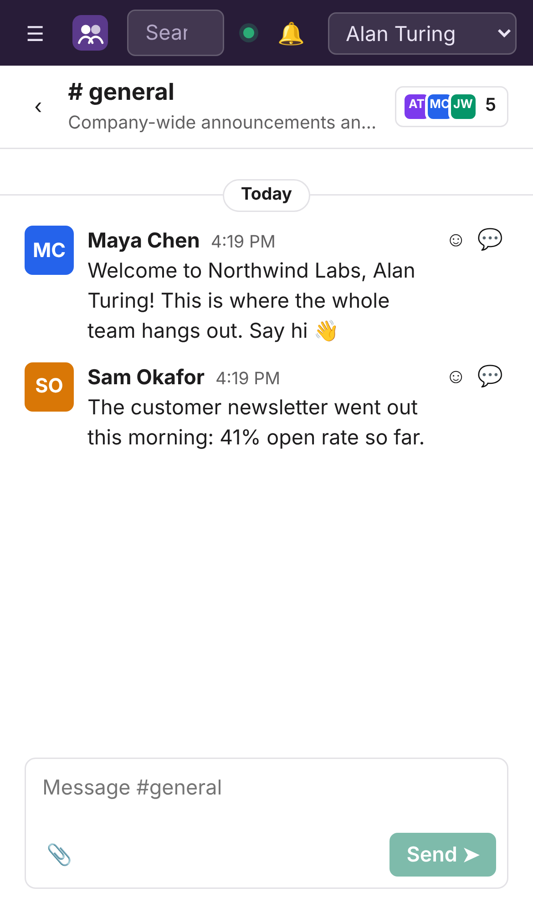
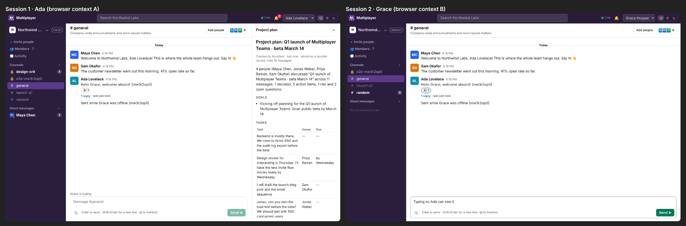
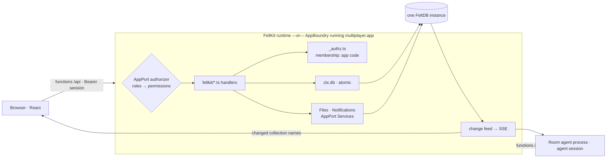
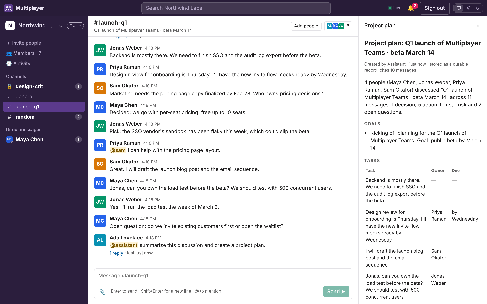

# FeltKit Multiplayer build report

Repository `rkendel1/workspace`, branch `claude/happy-allen-vldje7`, application in `multiplayer/`.
Platform: `@feltdb/feltkit` / `create-feltkit` 0.3.15, `@feltdb/core` 0.21.0, `@appport/sdk` 1.4.0,
`@appport/services` 0.15.0, `@appport/appboundry` 1.8.0. Every number below comes from a command in
[§17](#17-reproducible-measurement-commands). Estimates are labelled as estimates.

> **Update 2026-11-05: platform work released and adopted.**
>
> - **FK-GAP-001 (`feltkit({ authorize })`)** and **FK-GAP-010 (`ctx.crypto.token`, AppBoundry `crypto@1`)** shipped in `@feltdb/feltkit` 0.3.16 and `@appport/appboundry` 1.9.0. The AppPort subscription fix (FK-GAP-017) shipped in `@appport/server` 1.2.0.
> - **Multiplayer now uses both, and the workarounds are gone:**
>   - membership is enforced by one registered policy instead of in each handler;
>   - invitation links carry 256-bit codes instead of record ids.
> - **Re-measured:** custom code 2,552 lines (was 2,507). Centralizing authorization costs lines but buys the guarantees in the register.
> - **Re-verified:** 18/18 tests on the runtime and on the artifact, 16/16 two-session e2e, 8/8 deployment checks on AppBoundry 1.9.0.
> - **Still in place**, because those gaps are open: presence records (FK-GAP-004's FeltKit half), the agent queue (008), base64 file transfer (007) and scan search (006).
>
> See [FELTKIT_GAP_REGISTER.md](FELTKIT_GAP_REGISTER.md). Below is the original build's report.

## Executive summary (for the FeltKit website)

> **We built a multiplayer collaboration app for people and agents with FeltKit.**
>
> - **2,507 lines of custom code**, 86% of it the product itself: UI, conversations, the agent's behaviour.
> - **140 lines** of data model for 13 collections, compiled by FeltKit into a FeltDB state contract that FeltDB enforces.
> - **92 lines** of configuration. **14 lines** generated. One command (`npm create feltkit`) for the project.
> - **18 automated tests** (functional, security, agent), passing on FeltKit's runtime *and* on the compiled AppBoundry WebAssembly artifact, plus **24 browser checks** across two live sessions and a deployment run.
> - **Real-time for free:** messages, reactions, threads, unread counts and membership changes reach other sessions in about 60–500 ms with **zero lines of transport code**. Only presence and typing needed code (41 lines).
> - **Estimated 2,200–4,800 more lines of integration code** to build the same app directly on FeltDB, AppPort and AppPort Services: database transactions, capability wiring, sessions and authorization, live queries, files, the test harness.
>
> FeltKit supplied the project structure, FeltDB integration with atomic mutations, capability publishing (AppPort and MCP), role authorization at every boundary, sessions, files and notifications, live queries, the test harness, and the AppBoundry artifact build.
>
> **What it did not supply** became the [gap register](FELTKIT_GAP_REGISTER.md) (16 entries):
> - per-resource authorization;
> - tenancy;
> - presence;
> - hosted agent triggers;
> - self-serve accounts on AppBoundry;
> - a deployable managed target.
>
> About 520 lines (~21%) of the custom code exist because of those gaps.

## 1. Application overview

Multiplayer is a Slack-like workspace:

- **Collaboration:** workspaces with owner/admin/member/guest roles; invitation links that are single use, expire and can be revoked; public and private channels; direct and group conversations.
- **Messages:** threads, reactions, files (upload, authorized download), search across the conversations the caller can read, mentions, a notification inbox, unread and mention badges.
- **Live state:** presence (active, away, last seen) and typing indicators.
- **Workspace record:** an audit trail of activity, plus a sample workspace for onboarding.
- **The room agent `@assistant`:** a first-class participant with its own principal, membership and permissions. Mention it with "summarize this discussion and create a project plan". It reads the conversation it was brought into, persists a `project_plan` record (tasks with owners and dates, decisions, risks, open questions, cited messages), and replies in the thread with a reference to it.

The desktop UI has three columns, the phone UI shows one pane at a time, and it supports light and dark themes.

| | |
|---|---|
|  |  |
|  |  |
|  |  |

Two independent sessions, with Grace typing and Ada seeing it live:


## 2. Architecture diagram



Details, the data model and the authorization model are in [docs/ARCHITECTURE.md](docs/ARCHITECTURE.md).

## 3. Platform components reused

| Component | Used through | For |
|---|---|---|
| FeltDB 0.21.0 | `ctx.db` | All durable state: atomic mutations with read fences, sequences for message order, unique constraints, references, the state contract, migrations-ready schema |
| AppPort SDK 1.4.0 | FeltKit's authority and capabilities | Role → permission authorization on every boundary. 11 capabilities published on `/appport` and `/mcp` (`messages.post`, `agent.*`, `plans.get`, …) |
| AppPort Services 0.15.0 | `services: { files, notifications }`, `ctx.services`, `ctx.afterCommit` | File bytes with checksum and audit. Mention, agent-reply and invitation notifications, exactly once per commit |
| FeltKit 0.3.15 | the whole programming model | Function modules, sessions, dev identities, live queries (SSE), React hooks, typed `api`, Studio, `createTestApp` / `createArtifactTestApp`, `feltkit build --target appboundry` |
| AppBoundry 1.8.0 | `appboundry run` | The verified WebAssembly execution boundary for the deployment check |
| AuthBoundry | — | Not used. FeltKit has no adapter (FK-GAP-002) |

## 4. Application-specific components implemented

| Component | Files | Code lines |
|---|---|---|
| Backend functions (46, of which 11 are capabilities) | `feltkit/{workspaces,channels,messages,invitations,attachments,agents,activity,me,demo}.ts`, `_ops.ts`, `_util.ts` | 903 |
| Agent behaviour (deterministic composer) | `agent/compose.ts` | 69 |
| UI | `src/{App,Onboarding,Workspace,ui}.tsx` | 933 |
| Styles (tokens, light/dark, responsive) | `src/styles.css` | 259 |
| Data model (13 collections) | `feltkit/app.ts` (collections part) | 140 |
| Membership/resource authorization | `feltkit/_authz.ts` | 51 |
| Presence/typing (server) | `feltkit/presence.ts` | 19 |
| Integration adapters | `agent/worker.ts`, `agent/room-agent.ts`, `feltkit/_base64.ts`, `deploy/*` | 133 |

## 5. Measured custom LOC

Measured with cloc 2.00, code lines only (no blanks, no comments), via `node tools/measure.mjs`.
Every tracked file is assigned to exactly one category, and the script fails on an unassigned file.
Excluded: `node_modules`, build output, lockfiles, binaries, Markdown.

| Category | Files | Code lines | Notes |
|---|---:|---:|---|
| Custom application code | 17 | **2,164** | Product UI, behaviour, agent composer, CSS |
| Custom data-model code | 1 | **140** | 13 `app.collection(...)` declarations with constraints |
| Custom authorization code | 1 | **51** | `_authz.ts`, plus **43 call sites** inside handlers (counted in application code) |
| Custom real-time code | 1 | **19** | `presence.ts`, plus **22 client lines** in `Workspace.tsx` (heartbeat, typing, expiry) |
| Custom integration code | 5 | **133** | Agent adapter (58), base64 codec (23), deployment verification (52) |
| **Custom total** | 25 | **2,507** | |

## 6. Generated LOC

| Category | Files | Code lines |
|---|---:|---:|
| `feltkit/_generated/api.ts` (`feltkit codegen`) | 1 | 14 |
| Starter code kept from `create-feltkit` (`src/auth.tsx` sign-in screens, `theme.tsx`, `main.tsx`, `inbox.ts`, `public/theme.js`) | 5 | 266 |
| The whole starter as generated (commit `f926ad5`, the task-manager example) | 15 | 1,129 |

The kept starter code is not counted as custom. `src/auth.tsx` is the starter's sign-in, sign-up and
password-reset screens, moved out of `App.tsx` with only exports changed.

## 7. Configuration LOC

**92 lines**: `feltkit({...})` (roles, dev users, accounts, services: 26 lines), `package.json`,
`tsconfig.json`, `vite.config.ts`, `index.html`. Most of this is the starter's, with small edits.

## 8. Test LOC

**652 lines.** Of these, 358 are 18 `feltkit test` tests: 9 functional and 9 security/agent tests,
each on a fresh FeltDB instance. The other 293 are 24 Playwright browser checks: 16 for two sessions
on the dev server, 8 for the deployment.

## 9. Direct-stack LOC estimate

**Question:** how much more code would this exact app need if built on FeltDB, the AppPort SDK, AppPort
Services and AppBoundry directly, without FeltKit?

**Basis:** for each area, the FeltKit modules that perform it, with their LOC (cloc on
`rkendel1/feltkit@50bc617`, `packages/sdk/src`, 18,708 code lines in total), and the minimum
app-specific version a developer would write instead. That minimum is far smaller than FeltKit's
general implementation. Code both approaches need is **not** counted: UI, handlers, membership policy,
the agent composer.

**Variant (a), the primary estimate:** a Node server on `@feltdb/core` + AppPort SDK + AppPort
Services. It cannot reach the managed AppBoundry target. **Variant (b):** an AppBoundry repository app
via `npx appport add`, covered in the second table.

| Area | FeltKit (measured) | Direct stack (estimated, additional) | What FeltKit does here (module, code lines) and what the developer would write |
|---|---|---|---|
| Project initialization | 0 lines written (1 command) | 80–200 | `create-feltkit`. Vite + React + server scaffolding, TS configs, a dev runner with an API proxy |
| Application structure | 0 (function modules are app code), 14 generated | 450–900 | `runtime/loader.ts` 81, `server/http.ts` 90, `server/index.ts` 475, `errors.ts` 88, `client/index.ts` 369. AppPort `defineCapability` needs input *and* output schemas for all 46 operations (FeltKit needs `returns` for 11): ~35 × 8–12 lines. Plus HTTP dispatch, error mapping and a typed client |
| Database integration | 0 | 300–650 | `runtime/data.ts` 520, `transactions.ts` 212, `instance.ts` 229. Per-mutation transactions with buffered writes and commit-time read fences, CONFLICT mapping, named sequences, paging past FeltDB's find limit (FeltKit F20), copy-on-read (F22) |
| Data models | 140 | 180–460 more (320–600 total) | `state-contract.ts` 368, `contract.ts` 102, `schema.ts` 104. A hand-written FeltDB state contract for 13 collections (types, required, unique, indexes, references), plus write-validation schemas |
| Capability registration | 11 `capability:` lines + ~15 return-schema lines | 60–150 | `runtime/capabilities.ts`, `server/mcp.ts` 127. AppPort application registration and MCP exposure (dispatch is counted above) |
| Authorization integration | ~12 role lines | 250–550 | `authority.ts` 220, `sessions.ts` 126, `accounts.ts` 205. Wiring `permissionAuthorizer`; session issue, verify, store and revoke; dev identities; agent sessions; e-mail/password accounts with hashing and limits. AuthBoundry could replace part of this, but it is a separate service with no FeltDB-session adapter |
| Runtime integration | 0 | 150–350 | `runtime/runtime.ts` 1,034 (general). A server process, environments, state location, single-writer handling, health, static assets |
| File and notification integration | 3 config lines (+23 base64, a gap) | 200–450 | `runtime/services.ts` 869, `content.ts`, `outbox.ts`. `createServices({db})`, the gateway authorizer adapter, principal resolution, byte storage, an after-commit outbox so notifications fire exactly once per commit |
| Real-time integration | 19 server + 22 client (presence/typing only) | 300–650 | `runtime/changes.ts` 114, about 200 lines of `client/index.ts`, `react/index.tsx` 91, read tracking in `data.ts`. Change detection from FeltDB's journal or subscriptions (FeltKit F1/F7), authenticated SSE, reconnect and re-query, read-set tracking, React hooks |
| Build and deployment | 0 build lines; 52 verification lines | 60–150 | `feltkit build` (bundle, verify, secret scan). Bundle + Dockerfile. The managed AppBoundry target needs variant (b) |
| Configuration, glue, test harness | 92 config, 46 test helpers | 150–300 | `testing/index.ts` 101. An isolated FeltDB per test, callers bound to a principal, restart |
| **Total additional** | — | **≈2,200–4,800** | ≈0.9×–1.9× the app's 2,507 custom lines. The FeltKit version is ≈34–53% of the estimated direct-stack size |

**Variant (b), AppBoundry without FeltKit.** I verified this path. `npx appport add` (any repository)
generates a contract, a typed boundary and a Rust WASM crate. `npx appport app package` writes a
`.app` that `appboundry app install` / `appport app start` run with external durable state. The
generated `ExecutionContext.state` is **key-value** (`get`/`set`/`delete`). Multiplayer's data model
(unique constraints, references, range queries, sequences, transactions across records) would have to
be built on it: an estimated **400–900 lines** beyond variant (a)'s database row. Also, the repository
format (`AppPort/application-bundle/1`) is not the format the FeltKit → AppBoundry deploy contract and
`appboundry run` accept (FK-GAP-015).

**Missing in the direct stack regardless of approach**, so neither approach can count it as savings:
- resource-level authorization (FK-GAP-001/002);
- tenancy (FK-GAP-003);
- an ephemeral channel (FK-GAP-004);
- hosted agent triggers (FK-GAP-008);
- the managed deployment target (FK-GAP-009).

## 10. Direct-stack engineering effort (estimated)

| | Estimate | Basis |
|---|---|---|
| Additional integration code | 2,200–4,800 lines | §9 |
| Rate for that kind of code (transactions, auth, real-time, with tests) | 20–35 finished lines per hour | Assumption |
| Learning four components' contracts and their known gaps (FeltKit's UPSTREAM-GAPS lists 22 FeltDB items alone) | +10–25 h | Assumption |
| **Additional hours vs FeltKit** | **≈75–265 h** (midpoint ≈150 h) | Estimate, not an observed result |

These are counterfactual estimates. Nobody built the direct-stack version, so no saving was observed.

## 11. FeltKit engineering effort

| | |
|---|---|
| **Measured (this build):** elapsed time of the AI agent that built it | ≈50 min from the scaffold commit (01:03 UTC) to the verified artifact (01:35 UTC); ≈5 min of platform inspection before that, then documentation. Commit timestamps: `git log` |
| **Estimated:** an experienced human developer building the same app with FeltKit | ≈45–80 h. That's ≈3,150 lines of custom code and tests at 40–70 finished lines/hour for UI and feature code, plus 6–10 h to learn FeltKit |
| Of which attributable to platform gaps (estimated) | ≈16.5 h (sum over the gap register) |

The agent's wall-clock time is not developer hours. It is reported only because it was measured.

**Remaining application-specific regardless of approach:** the UI (933 lines + CSS), conversation
behaviour (903), the data model's meaning, membership policy, the agent's behaviour, and the tests.

## 12. Share of implementation code that is custom application code

| Measure | Value |
|---|---|
| Application code / custom code (2,164 / 2,507) | **86.3%** |
| Application semantics (application code + data model) / custom code (2,304 / 2,507) | **91.9%** |
| Platform glue (integration category) / custom code (133 / 2,507) | **5.3%** |
| Application code / all implementation code (custom + configuration + generated + kept starter = 2,879) | **75.2%** |
| Custom code attributable to platform gaps (deduplicated) | **≈520 lines (≈21%)**. Of these, ≈370 would disappear if the gaps closed; the rest relocates or is application semantics |

## 13. Major functionality supplied by FeltKit (and verified here)

- **Atomic mutations with commit-time conflict detection.** The two-workers race test shows exactly one agent reply.
- **Message ordering** by `ctx.db.sequence`, with no gaps and in commit order, plus `retry: { sequenceConflicts }`.
- **A schema enforced by FeltDB:** unique constraints (handles, memberships, reactions, DM keys) and references with restrict.
- **Live queries for every view**, with no application transport code. Measured latencies are in §15.
- **One authorization policy** enforced at HTTP, AppPort, MCP and Services. A principal without the role is refused before the handler runs (security tests).
- **Files and notifications** on the same FeltDB instance, with `afterCommit` so notifications are exactly once per commit.
- **Agent sessions as first-class principals.** The room agent runs with its own identity over the same functions.
- **The test harness:** a fresh FeltDB per test; `createArtifactTestApp` runs the same suite against the WASM artifact (18/18).
- **`feltkit build --target appboundry`:** a 3.9 MB import-free module, a manifest with exact host access, verified by AppBoundry.

## 14. Platform gaps discovered

The full register is in [FELTKIT_GAP_REGISTER.md](FELTKIT_GAP_REGISTER.md). It is generated from
[feltkit-gaps.json](feltkit-gaps.json), the single source. Ranked improvements are in
[FELTKIT_PLATFORM_ROADMAP.md](FELTKIT_PLATFORM_ROADMAP.md).

| | Count | IDs |
|---|---:|---|
| **Total** | **16** | |
| Missing primitives / capabilities | 7 | 002 AuthBoundry resource evaluation, 003 tenancy, 004 ephemeral channel, 005 predicate-level invalidation, 006 text search, 008 agent triggers, 010 secure token |
| Missing hooks / extension points | 2 | 001 input-aware authorization hook, 007 file authorization by resource |
| Missing integrations | 3 | 013 accounts on AppBoundry, 014 MCP not in artifact, 015 two artifact formats |
| Developer-experience deficiencies | 3 | 011 reconnect backoff, 012 hand-written capability output schemas (by design), 016 `appport add` interactive-only |
| Unsupported requirement | 1 | 009 managed AppBoundry deployment |
| Security and authority gaps | 5 | 001, 002, 007, 010, 013 |
| Workarounds implemented | 7 | 001 `_authz.ts`, 003 app tenancy, 004 bounded presence records, 006 scan search, 007 attachment binding + base64, 008 durable queue + external worker, 010 record-id invitation codes |
| Custom LOC attributable | ≈520 (dedup.) | Per gap in the register |
| Engineering effort attributable | ≈16.5 h (est.) | Per gap in the register |
| **Preventing full acceptance** | 2 | 009 (no managed deployment, no public URL), 013 (no self-serve sign-up on the approved target) |

Application-specific code is deliberately *not* counted as platform overhead. For example, the
membership rules in `_authz.ts` are this app's policy. The missing hook to register them (FK-GAP-001)
is the platform gap, and only the call sites and plumbing would disappear.

## 15. Acceptance test results

| Category | Result | Evidence |
|---|---|---|
| Functional (create workspace, channel, invite, send, thread, react, DM, search, upload/download, add agent, mention agent, agent action, persisted plan, restart durability, sample workspace) | **9/9 tests pass** on FeltKit's runtime **and** on the artifact | `npm test`; `MP_TARGET=artifact npm test` |
| Security (unauthorized workspace, channel, DM, cross-tenant ids and search, roles and invitations, membership changes, files, agent escalation at both layers, worker race) | **9/9 tests pass**, both targets | same |
| Multiplayer, two independent browser contexts | **16/16 checks** | `docs/screenshots/evidence.json` |
| Deployment (artifact on `@appport/appboundry@1.8.0`) | **8/8 checks + restart recovery** | `docs/screenshots/deployment-evidence.json`, `deploy/verify-appboundry.sh` |
| Managed deployment (Hetzner) | **Not achieved: blocked** | §16 |

Measured two-session latencies, from the action in one session to it being visible in the other (dev server):

| | |
|---|---|
| Message delivery | 100–105 ms |
| Reactions | 131–151 ms |
| Unread badge | 60–99 ms |
| Membership change (added to a private channel) | 346–356 ms |
| Thread reply count | 480–580 ms |
| Typing indicator | 0.8–1.1 s |
| Agent round trip (mention → reply with plan) | 0.73–0.98 s |
| Catch-up after going offline | 6.4–16 s (client reconnect backoff, FK-GAP-011) |
| On AppBoundry: message delivery | 199–249 ms |
| On AppBoundry: agent round trip | 1.26–1.36 s |

## 16. Deployment evidence

- `npx feltkit build --target appboundry` produces `multiplayer.app`: 46 functions, 11 capabilities, 13 collections, module `sha256:d9680914…`, 3.9 MB, no imports, no network, no filesystem.
- `appboundry artifact verify` passes. Running with `--environment production`, `/_appboundry/health` returns `{"status":"ready","module":"sha256:d9680914…"}`.
- `deploy/verify-appboundry.sh` on the published runtime ran:
  - the operator and users;
  - the agent process over HTTP;
  - two browser sessions (delivery, typing, file upload and authorized download, agent plan);
  - a restart on the same state, with data read back: `{"workspace":"Northwind Labs","plans":1,"generalMessages":4,"withAttachment":1,"ok":true}`.

  
- **Managed target: not deployed.**
  - `npx feltkit deploy --target appboundry` refuses: `✗ Deploying to AppBoundry needs APPBOUNDRY_URL (the AppBoundry portal), APPBOUNDRY_TOKEN (an AppBoundry deploy token).`
  - AppBoundry's readiness document (2026-11-04): "Nothing here is deployed", routing "designed, not implemented", "Untrusted execution in production: not ready".
  - No substitute hosting was invented, and there is no public URL. Instructions and rollback are in [docs/DEPLOYMENT.md](docs/DEPLOYMENT.md).

## 17. Reproducible measurement commands

```bash
cd multiplayer && npm install
```

```bash
npm test
```

```bash
npx feltkit build --target appboundry && MP_TARGET=artifact npm test
```

```bash
npm run dev
```

In a second terminal, with the token printed by `npx feltkit session create --id assistant --type agent --role agent`:

```bash
FELTKIT_AGENT_TOKEN=<token> npx tsx agent/room-agent.ts
```

```bash
node e2e/multiplayer.e2e.cjs
```

```bash
deploy/verify-appboundry.sh
```

From the repository root (needs cloc 2.x on PATH, or `CLOC=<path>`):

```bash
node tools/measure.mjs
```

```bash
node tools/measure.mjs --json > measurement.json
```

```bash
node tools/gaps-md.mjs
```

The direct-stack variant (b) check:

```bash
npx appport add
```

```bash
npx appport app package
```

Then `appboundry artifact verify <name>.app` and `appboundry app install <name>.app`.

## Known limitations

- **No managed deployment and no public URL** (FK-GAP-009). There is no self-serve sign-up on AppBoundry; an operator issues sessions (FK-GAP-013).
- **Presence and typing are bounded durable writes**, not ephemeral messages. Each heartbeat (≤ 1 every 2.5 s while typing, 1 per 20 s otherwise) is a FeltDB commit and appears in FeltKit's operational activity log.
- **Live-query invalidation is per collection** (FK-GAP-005). Not load-tested beyond three concurrent sessions.
- **Search is a scan** of the workspace's messages (FK-GAP-006).
- **Invitation codes carry 48 random bits** (FK-GAP-010). They are single use, expire after 7 days and can be revoked, but there is no rate limiting.
- **Files are limited to 1 MiB** and travel as base64 through functions (FK-GAP-007).
- **The agent's composer is a deterministic extractor.** It cites what it used but is heuristic. It lists "Backend is mostly there…" as a task with no owner, and treats a confirmation reply as a second task. The `Composer` interface is the place for a model; none is wired in.
- **Agent types:** personal and workspace agents are modelled (`agentType`, `ownerId`), but only the application-owned room agent is implemented end to end. There is no UI for creating others.
- **The agent process is not supervised.** Its queue is durable, with a 2-minute lease.
- **Not implemented:** message edit history, channel archiving, renaming group conversations, invitation e-mail (links only).
- **Mobile layout was verified in emulation only** (iPhone 13 profile).
