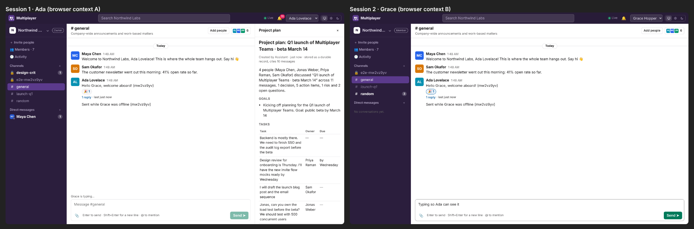

# FeltKit Multiplayer

A real-time, multi-tenant workspace for people and agents, built with FeltKit. It is also a measured
audit of what FeltKit saves and what it still makes developers write.

| | |
|---|---|
| [multiplayer/](multiplayer/) | The application: source, tests, e2e, deployment verification ([README](multiplayer/README.md)) |
| [FELTKIT_MULTIPLAYER_BUILD_REPORT.md](FELTKIT_MULTIPLAYER_BUILD_REPORT.md) | Code and effort, measured and compared with the direct stack, with acceptance evidence |
| [FELTKIT_GAP_REGISTER.md](FELTKIT_GAP_REGISTER.md) | 16 platform gaps (generated from [feltkit-gaps.json](feltkit-gaps.json)) |
| [FELTKIT_PLATFORM_ROADMAP.md](FELTKIT_PLATFORM_ROADMAP.md) | The gaps ranked into platform improvements |
| [multiplayer/docs/ARCHITECTURE.md](multiplayer/docs/ARCHITECTURE.md) | Components, data model, authorization, real-time |
| [docs/DEPLOYMENT.md](docs/DEPLOYMENT.md) | Artifact, deployment status, health checks, rollback |
| [docs/screenshots/](docs/screenshots/) | Screenshots and the e2e evidence JSON |
| [tools/](tools/) | `measure.mjs` (cloc-based code measurement), `gaps-md.mjs` (register renderer) |

