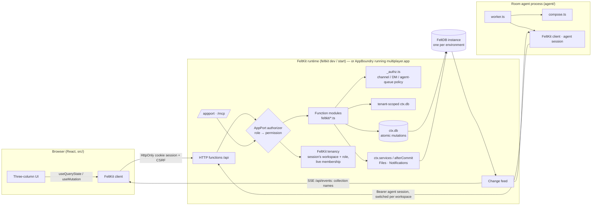

# Multiplayer architecture

## Components and boundaries

| Concern | Owner | In this app |
|---|---|---|
| Durable state | FeltDB (through `ctx.db`) | 11 collections, all but `participants` tenant-scoped; each mutation is one atomic transaction; reads are fenced at commit |
| Accounts, sessions | FeltKit `auth.accounts` | Password and e-mailed sign-in link/code, verification, reset, account settings; browser sessions are an HttpOnly cookie |
| Workspaces, memberships, roles, invitations, switching | FeltKit `auth.tenant` (`name: "workspace"`, roles owner > admin > member > guest > agent) | A workspace is a tenant. The session works in one; its role there is resolved from the live membership on every request and held as an ordinary role. Invitations by e-mail (single use, 7 days, revocable); agents and services added directly |
| Capability and permission boundary | AppPort, via FeltKit's authority | Accounts hold `person` (nothing in a workspace); workspace roles hold `channels.*`, `messages.*`, …, owner/admin also `tenant.*` / `tenant.members.manage`; the room agent `agent`; operators `operator` (Studio, credentials, jobs) |
| Workspace isolation | FeltKit tenant-scoped collections (`{ tenant: { field: "workspaceId" } }`) | `workspaceId` is stamped from the session; every read and write is filtered by it; another workspace's records do not exist for a call; a call with no workspace touches none |
| Resource authorization | FeltKit `feltkit({ authorize })` runs the **application's policy** (`feltkit/_authz.ts`) | A `workspaceId` argument must equal the session's workspace; minimum workspace roles; conversation policy (private channels, DMs, guests/agents), the agent queue — on every interface, reads fenced at commit and tracked live |
| Files, notifications | AppPort Services on the same instance | Bytes and checksums in Files; mention/agent/invitation notifications through `ctx.afterCommit` |
| Real-time delivery | FeltKit change feed + client | Live queries re-run when a collection they read changes; no application transport |
| Presence, typing | Application (bounded records) | One overwritten `presence` record per participant per workspace (FK-GAP-004) |
| Agent execution | Application adapter (`agent/`) | Durable request queue + `agent.*` capabilities + an external worker (FK-GAP-008) |
| Execution boundary | AppBoundry | `multiplayer.app`: WebAssembly, no imports, host access limited to the 13 collections and 2 services |
| Identity | FeltKit sessions (dev/start) or AppBoundry operators (artifact) | Accounts and tenancy don't exist on AppBoundry (FK-GAP-013): the artifact builds, but no workspace can exist there, so its test run skips |

## Data model

| Collection | Kind | Key relations / constraints |
|---|---|---|
| `participants` | identity | unique `principalId`, unique `handle`; `kind` human or agent; `agentType` personal, workspace or application; `persona` for sample people (no principal) |
| *(FeltKit)* tenants, memberships, invitations | **authoritative** | FeltKit's own collections (`_feltkit_tenants`, `_feltkit_memberships`, `_feltkit_invitations`); invitation links carry an HMAC token that is never stored |
| `roster` | directory (not authority) | unique (workspace, participant): who has a profile in the workspace, for mentions, DMs, channel invitations, presence. Written when a person first works in the workspace (`me:ensure`), by `agents:add`, and by the sample seed for personas |
| `channels` | conversation | public, private, dm or group; unique (workspace, dmKey) for DMs/groups |
| `channelMembers` | **authoritative** | unique (channel, participant); `lastReadSeq` drives unread counts |
| `messages` | durable record | `seq` from `ctx.db.sequence("msg:<channel>")` (commit order, no gaps); `rootId` for threads; soft delete |
| `reactions` | durable record | unique (message, participant, emoji) |
| `attachments` | binding | fileId → channel. The Files service owns the bytes; this record authorizes reads |
| `presence` | ephemeral, bounded | unique (workspace, participant), overwritten |
| `agentRequests` | durable queue | pending → working (2-minute lease) → done or failed |
| `sharedObjects` | durable work product | `project_plan` with tasks, decisions, risks, questions, cited message ids |
| `activity` | audit trail | meaningful changes only: joining, channels, agent actions, moderation. Role changes, removals and invitations are in FeltKit's auth activity |

There are no redundant copies. Unread counts, reply lists, reaction groups and presence state are all
derived when read. The one stored aggregate, `replyCount` on a thread root, is updated in the same
transaction as the reply.

## Authorization model

1. **Session and workspace (FeltKit).** An account signs in (cookie session in the browser, bearer for
   the agent). The session works in one workspace, chosen by the person (switching rotates the
   session); FeltKit resolves the live membership on every request, so a removed member's next call has
   no workspace and a changed role applies on the next call.
2. **Role (AppPort).** The workspace role (owner, admin, member, guest, agent) is held as an ordinary
   role only in that session: `channels.*`, `messages.*`, … for people, `agents.work`, `messages.read|write`,
   `plans.read|write`, … for the agent. An account alone holds `person` (no workspace permissions).
   Managing members and invitations needs `tenant.members.manage` (owner, admin), renaming
   `tenant.update` (owner); FeltKit lets a manager assign only roles below their own and always keeps
   an owner.
3. **Workspace isolation (FeltKit).** Workspace collections are tenant-scoped: ids from another
   workspace resolve to nothing (`NOT_FOUND`), and the workspace field cannot be set to another one.
4. **Conversation policy (application, enforced by FeltKit).** `authorize` in `feltkit/_authz.ts` runs
   after the role check and argument validation, before the handler, for every function (default deny):
   - A `workspaceId` argument (kept for compatibility) must be the session's workspace, else `NOT_FOUND`.
   - Role minimums: creating channels and reading activity need member; listing the agent and seeding
     the sample workspace need admin / owner.
   - Conversation: private channels, DMs and groups are readable by their members only. Public channels
     are readable by members, but not by guests or agents unless they were added.
   - Files: readable only through the attachment's conversation.
   - Agents: read only conversations a person brought them into, work only their own requests. They
     join a workspace only when an admin adds them (FeltKit: agents and services directly, people only by
     invitation). An agent mention never triggers another agent.

Client-supplied workspace ids, participant ids and roles are never trusted. The caller's participant
is always derived from the verified principal, the workspace and role from FeltKit's session.

Known limits: the workspace directory (`roster`) is the application's and can name someone FeltKit
has since removed (they can read nothing, but a mention would still notify them), because a function
cannot read FeltKit's memberships; and FeltKit emits no change event for a membership change, so a
removed member's open page learns it at its next refused call (≤ 20 s, the presence heartbeat).

## Real-time and recovery

- Writes commit to FeltDB. FeltKit's change feed reads FeltDB's journal and streams changed collection
  names over SSE. Clients re-run affected queries through the authorized endpoint, so no data travels
  on the stream.
- A reconnecting client re-runs every query (`"*"`). A fresh page load reads everything from FeltDB.
  Durable state never depends on the delivery path. The e2e suite verifies both.
- Measured on the dev server: message delivery ≈100 ms, reaction ≈135 ms, unread badge ≈70–100 ms,
  typing ≈0.8 s (one 2.5 s-throttled heartbeat), agent round trip ≈0.7–1.0 s.
