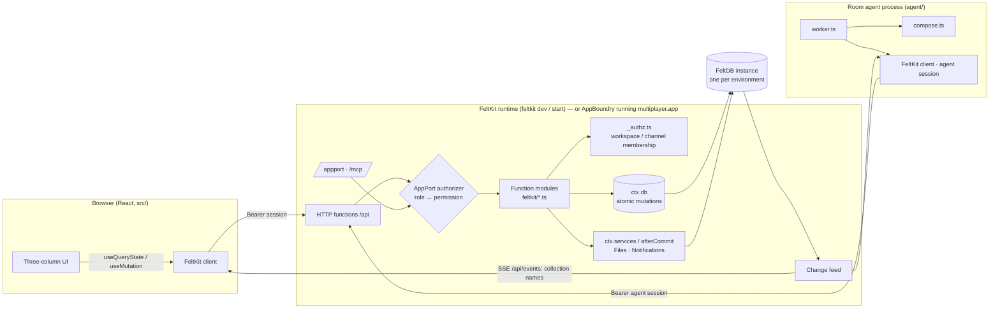

# Multiplayer architecture

## Components and boundaries

| Concern | Owner | In this app |
|---|---|---|
| Durable state | FeltDB (through `ctx.db`) | 13 collections; each mutation is one atomic transaction; reads are fenced at commit |
| Capability and permission boundary | AppPort, via FeltKit's authority | Roles `member`, `agent`, `admin` map to permissions; checked on HTTP, AppPort, MCP and Services |
| Resource authorization | **Application** (`feltkit/_authz.ts`) | Membership of the workspace and conversation. FeltKit has no hook for this (FK-GAP-001) |
| Files, notifications | AppPort Services on the same instance | Bytes and checksums in Files; mention/agent/invitation notifications through `ctx.afterCommit` |
| Real-time delivery | FeltKit change feed + client | Live queries re-run when a collection they read changes; no application transport |
| Presence, typing | Application (bounded records) | One overwritten `presence` record per participant per workspace (FK-GAP-004) |
| Agent execution | Application adapter (`agent/`) | Durable request queue + `agent.*` capabilities + an external worker (FK-GAP-008) |
| Execution boundary | AppBoundry | `multiplayer.app`: WebAssembly, no imports, host access limited to the 13 collections and 2 services |
| Identity | FeltKit sessions (dev/start) or AppBoundry operators (artifact) | Self-serve accounts don't exist on AppBoundry (FK-GAP-013) |

## Data model

| Collection | Kind | Key relations / constraints |
|---|---|---|
| `participants` | identity | unique `principalId`, unique `handle`; `kind` human or agent; `agentType` personal, workspace or application; `persona` for sample people (no principal) |
| `workspaces` | tenant | — |
| `memberships` | **authoritative** | ref workspace, ref participant, unique (workspace, participant), role owner/admin/member/guest/agent |
| `invitations` | authoritative | ref workspace; single use, 7-day expiry, revocable |
| `channels` | conversation | public, private, dm or group; unique (workspace, dmKey) for DMs/groups |
| `channelMembers` | **authoritative** | unique (channel, participant); `lastReadSeq` drives unread counts |
| `messages` | durable record | `seq` from `ctx.db.sequence("msg:<channel>")` (commit order, no gaps); `rootId` for threads; soft delete |
| `reactions` | durable record | unique (message, participant, emoji) |
| `attachments` | binding | fileId → channel. The Files service owns the bytes; this record authorizes reads |
| `presence` | ephemeral, bounded | unique (workspace, participant), overwritten |
| `agentRequests` | durable queue | pending → working (2-minute lease) → done or failed |
| `sharedObjects` | durable work product | `project_plan` with tasks, decisions, risks, questions, cited message ids |
| `activity` | audit trail | meaningful changes only: membership, roles, channels, invitations, agent actions, moderation |

There are no redundant copies. Unread counts, reply lists, reaction groups and presence state are all
derived when read. The one stored aggregate, `replyCount` on a thread root, is updated in the same
transaction as the reply.

## Authorization model

1. **Application role (AppPort).** People hold `member`: `workspaces.*`, `channels.*`, `messages.*`, … .
   The agent holds `agent`: `agents.work`, `messages.read|write`, `plans.read|write`, `presence.write`,
   `notifications.send`. A principal without the permission is refused before the handler runs.
2. **Membership (application).** Every handler resolves the ids it was given to records, then checks:
   - Workspace: the caller has a membership. Otherwise `NOT_FOUND`, so there is no existence oracle.
   - Role: owner > admin > member > guest/agent, for admin actions and invitations.
   - Conversation: private channels, DMs and groups are readable by their members only. Public channels
     are readable by members, but not by guests or agents unless they were added.
   - Files: readable only through the attachment's conversation.
   - Agents: read only conversations a person brought them into, work only their own requests, and
     cannot accept invitations. An agent mention never triggers another agent.

Client-supplied workspace ids, participant ids and roles are never trusted. The caller's participant
is always derived from the verified principal.

## Real-time and recovery

- Writes commit to FeltDB. FeltKit's change feed reads FeltDB's journal and streams changed collection
  names over SSE. Clients re-run affected queries through the authorized endpoint, so no data travels
  on the stream.
- A reconnecting client re-runs every query (`"*"`). A fresh page load reads everything from FeltDB.
  Durable state never depends on the delivery path. The e2e suite verifies both.
- Measured on the dev server: message delivery ≈100 ms, reaction ≈135 ms, unread badge ≈70–100 ms,
  typing ≈0.8 s (one 2.5 s-throttled heartbeat), agent round trip ≈0.7–1.0 s.
