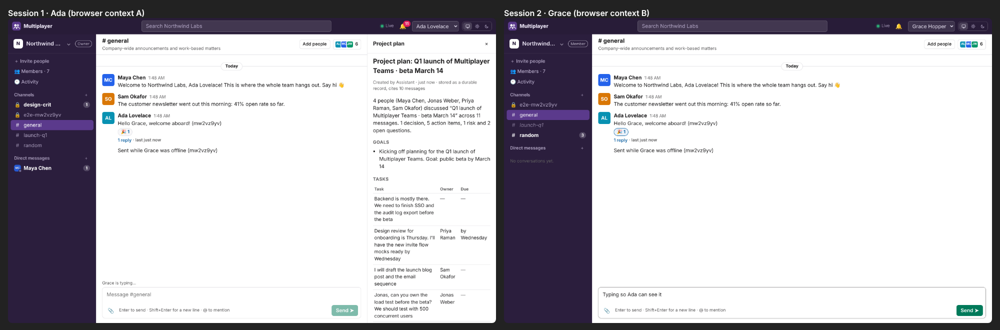

# Multiplayer

A real-time workspace for people and agents, built with [FeltKit](https://www.npmjs.com/package/@feltdb/feltkit) (the release after 0.3.16: see below).
Workspaces, public and private channels, direct and group messages, threads, reactions, files, search,
presence, typing, unread counts, notifications, invitations, roles, an audit trail, and a room agent
(`@assistant`) that reads a conversation and writes a persisted project plan back into it.

All state is in one FeltDB instance per environment. Agents are participants with their own identity,
membership and permissions, and they act only through the app's capabilities.

Accounts, sign-in (password and e-mailed sign-in links), workspaces, memberships, roles, invitations,
switching and account settings are FeltKit's (`auth.accounts`, `auth.tenant`, `@feltdb/feltkit/react`):
a workspace is a FeltKit tenant, and every workspace collection is tenant-scoped. Multiplayer keeps
only its own semantics: profiles and handles, channels, DMs, private channels, the agent queue.

> **Requires the next FeltKit release.** These auth and tenancy primitives are not in FeltKit 0.3.16;
> `package.json` keeps `^0.3.16`, which the release carrying them satisfies. Until then, link a local
> FeltKit build (`node_modules/@feltdb/feltkit` → FeltKit's `packages/sdk`).



## Run it

Requires Node 22.

```bash
npm install
```

```bash
npm run dev
```

Open <http://localhost:3000> and sign in: with an account (password, or **E-mail me a sign-in link**:
in development the e-mail, its link and its 8-digit code are printed by `feltkit dev`), or as a
development identity (Ada, Grace, Alan). `?as=ada` signs a window in as that identity. Then create a
workspace, or choose **Open sample workspace** for Northwind Labs: four sample colleagues, a launch
discussion, a private channel, a DM, and the agent.

To be two people at once, use two browser profiles (or a private window). Invite someone by e-mail
from **＋ Invite people** (owners and admins) and open the link in their window: they sign in with the
invited address and join. Members, roles, removal, renaming and open invitations are under
**⚙ Workspace settings**; the account (name, address, password, sessions) under the name in the top bar.
The browser holds its session as FeltKit's HttpOnly cookie; nothing is kept in `localStorage`.

### The room agent

The agent is a separate process with its own agent session. A workspace admin adds it (**Add @assistant**:
FeltKit's `addMember("assistant", "agent")`, since agents and services join directly while people are
invited). The process lists the workspaces it belongs to (`GET /api/tenants`), switches its session into
each (`POST /api/tenants/switch`, a new token) and works that workspace's queue through the app's
`agent.*` capabilities:

```bash
npx feltkit session create --id assistant --type agent --role agent
```

```bash
FELTKIT_AGENT_TOKEN=fks_… MULTIPLAYER_URL=http://localhost:3000 npx tsx agent/room-agent.ts
```

In development, `ROOM_AGENT_DEV=1 MULTIPLAYER_URL=http://localhost:3000 npx tsx agent/room-agent.ts`
signs it in as the `assistant` development identity instead.

In a channel, write `@assistant summarize this discussion and create a project plan.` A person who can
see the conversation brings the agent into it. The agent then reads the conversation as itself, writes
a `project_plan` record, and replies in the thread with a link to it. Its composer
(`agent/compose.ts`) is deterministic and cites the messages it used. No model is needed.

## Test it

```bash
npm test
```

That's 22 tests: functional, security and agent, each against a fresh FeltDB instance. Workspaces and
memberships are set up through FeltKit's tenancy store (`t.tenancy`), callers work in one with
`t.as(who, { tenant })`, and the role, invitation, membership and worker tests go through FeltKit's real
HTTP routes.

```bash
npx feltkit build --target appboundry && MP_TARGET=artifact npm test
```

That runs the same tests against the compiled AppBoundry artifact (`multiplayer.app`, WebAssembly). Today
every one of them is **skipped**, with the reason: AppBoundry hosts have no accounts or tenancy yet, so a
workspace cannot exist there. The artifact still builds; `deploy/verify-appboundry.sh` and
`e2e/deployment.e2e.cjs` predate the migration and do not run until AppBoundry hosts tenancy.

```bash
node e2e/multiplayer.e2e.cjs
```

That's 20 browser checks (two desktop sessions and a phone): FeltKit sign-in, an invitation accepted with
an e-mailed sign-in code from the development inbox, switching and creating workspaces, workspace
settings (a role change and a removal taking effect), the account screen, and real-time delivery,
typing, presence, reactions, threads, unread counts, the agent, reconnection and recovery. It starts
`feltkit dev` (fresh state) and the agent itself, and writes `../screenshots/phase2-multiplayer/` and
`evidence.json`.

```bash
deploy/verify-appboundry.sh
```

This builds the artifact, serves it on the published AppBoundry runtime, and runs the deployment
browser checks, including a restart. See [../docs/DEPLOYMENT.md](../docs/DEPLOYMENT.md).

## Layout

| Path | What it is |
|---|---|
| `feltkit/app.ts` | Roles (workspace roles are `auth.tenant` roles), accounts, tenancy, services, and the 11 collections (the data model; all but `participants` tenant-scoped) |
| `feltkit/_authz.ts` | The conversation policy, registered as `feltkit({ authorize })`: the session's workspace and role from FeltKit (a different `workspaceId` argument is refused), private channels, DMs, the agent queue, for every function on every interface (default deny), plus loaders handlers use for context |
| `feltkit/_ops.ts`, `_util.ts`, `_base64.ts` | Shared write helpers, mention parsing, the file byte codec |
| `feltkit/workspaces.ts` … `agents.ts` | Queries and mutations (`<module>:<export>`), published in part as AppPort capabilities. `me:ensure` enters the session's workspace (directory, default channels) |
| `feltkit/demo.ts` | Seeds the sample workspace (created by the client as a FeltKit tenant) |
| `agent/` | The room agent: composer (pure), queue worker (transport-independent), process (HTTP) |
| `src/` | React UI: `App.tsx` (which screen: FeltKit's SignIn, AcceptInvitation, CreateTenant; entering the workspace), `Workspace.tsx` (three columns, with FeltKit's TenantSwitcher, TenantSettings, InvitationsPanel, AccountSettings, AuthNotices, VerifyEmailBanner), `ui.tsx`, `styles.css` (FeltKit's components pick up its `--accent`, `--surface`, `--ink`, `--line`, `--radius`); `theme.tsx` comes from the FeltKit starter |
| `tests/` | `feltkit test` suites (`MP_TARGET=artifact` runs them against the artifact) |
| `e2e/` | Playwright: two sessions and a phone on the dev server; deployment checks on AppBoundry (pre-migration, see above) |
| `deploy/` | Artifact verification on AppBoundry |

Architecture: [../docs/ARCHITECTURE.md](../docs/ARCHITECTURE.md). The build report, the gap register
and the platform roadmap are at the repository root.
