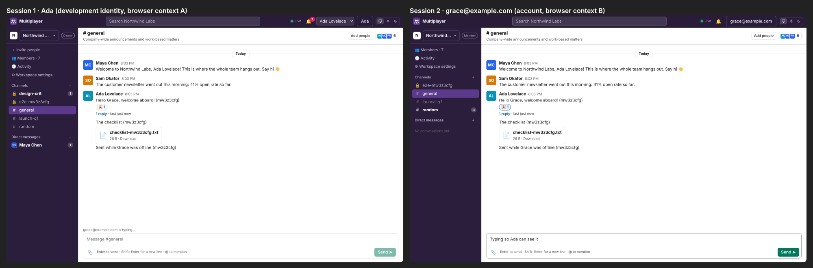
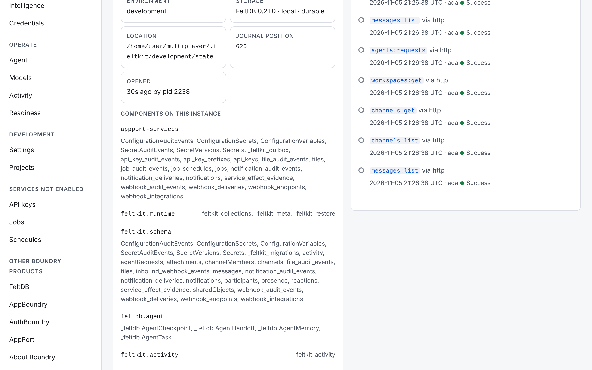
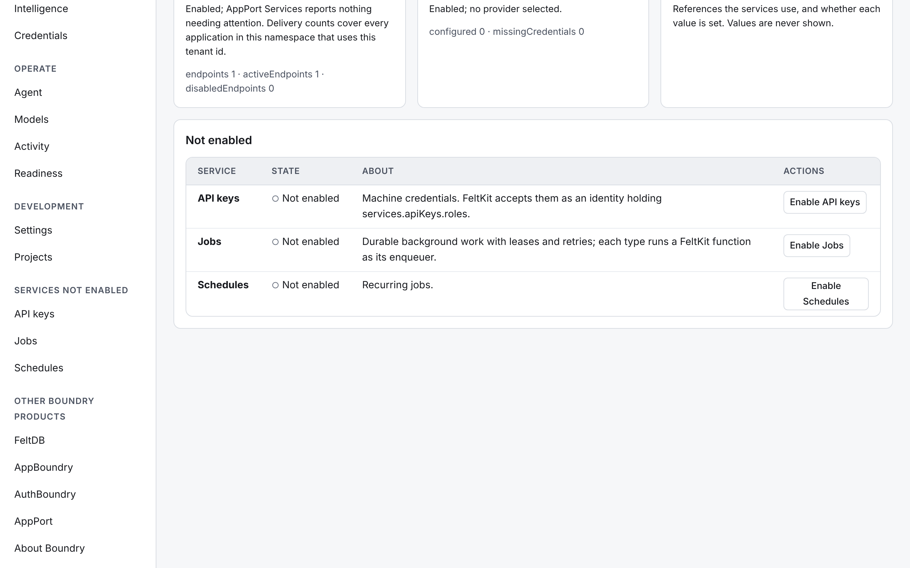
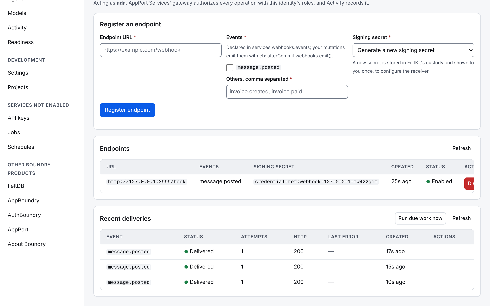

# Multiplayer

**A real-time workspace for people and AI agents. It is an open-source starter built on [FeltKit](https://getfeltkit.com), by [Boundry](https://boundry.company).**

Multiplayer covers what a team chat product needs:
- **Workspaces:** public and private channels, direct and group messages.
- **Conversation:** threads, reactions, file sharing, search, presence, typing indicators, unread counts and notifications.
- **Accounts and access:** accounts, invitations, roles, and an audit trail.
- **A room agent (`@assistant`):** it reads a conversation and writes a project plan back into it.

It is meant to be read and changed. The whole app is about 2,400 lines, and almost all of it is your
application. Sign-in, sessions, workspaces, memberships, invitations, the account screens,
background agent runs, file transfer and live updates come from FeltKit.

It is also meant to be **operated**. Besides its code, the app has a control surface: FeltKit Studio and
the `feltkit` commands. Use them to inspect, configure and run the app without editing source. See
[Code and Control](#your-application-has-two-interfaces-code-and-control).



## Quick start

Requires Node 22.

```bash
npm install
```

```bash
npm run dev
```

Open <http://localhost:3000>.
- **Create an account.** Use a password, or **E-mail me a sign-in link**. In development the e-mail, with its link and 8-digit code, is printed in the terminal.
- **Or sign in as a development identity:** Ada, Grace or Alan. `?as=ada` signs a window in as that identity.
- **Then create a workspace,** or choose **Open sample workspace** for Northwind Labs: sample colleagues, a launch discussion, a private channel, a DM and the agent.

To be two people at once, use two browser profiles or a private window.
- **Invite people.** Owners and admins invite someone by e-mail from **＋ Invite people**. The invitee opens the link, signs in with the invited address and joins.
- **Manage the workspace.** Members, roles, removal, renaming and invitations are under **⚙ Workspace settings**.
- **Your account.** Name, address, password and sessions are under your name in the top bar.

### The room agent

The agent runs inside the app, as `app.agent("assistant", …)` in `feltkit/agents.ts`; there is no separate process.
1. **Add it.** A workspace admin adds it with **Add @assistant**.
2. **Ask it.** In a channel, write `@assistant summarize this discussion and create a project plan.`
3. **It runs as itself.** FeltKit runs the agent after the message is saved, as the agent's own identity and roles. It never uses the identity of the person who asked, and it works only in workspaces it is a member of.
4. **It replies.** It reads the conversation, writes a project plan record, and replies in the thread with a link to it.

Its composer (`feltkit/_compose.ts`) is deterministic and cites the messages it used, so no model or API key is needed.
Replace `compose` with a call to the model of your choice to make it smarter. Its authority does not change.

## Your application has two interfaces: Code and Control

**Code** builds the application: it defines behavior and extends what the app can do. **Control**
configures, inspects, manages and operates it. It is one application with one operating experience.
The code shows how quickly you can build; Control shows how much you don't have to build again.

| Code (`feltkit/`, `src/`) | Control (Studio and `feltkit` commands) |
|---|---|
| Define application behavior | Configure application behavior |
| Define collections and schemas | Inspect and manage application data |
| Implement authorization rules | Manage application configuration |
| Define agent capabilities | Configure integrations, models and credentials |
| Build application features | Operate the deployed application |
| Change application logic | Manage the environment |

The boundary is deliberate. Control changes what the code already allows: which endpoints receive
events, which model and key an agent uses, configuration values, credentials. A new feature, rule or
collection is still code.

### Open Studio (development)

`npm run dev` prints the addresses it serves:

```
  App        http://localhost:3000
  Dashboard  http://localhost:3000/_feltkit/#token=fka_…
  AppPort    http://localhost:3000/appport  (4 capabilities)
  MCP        http://localhost:3000/mcp  (agents; needs a session from `feltkit session create --type agent`)
```

Open the **Dashboard** link. The token in it is the sign-in. It is this machine's development admin
token, kept under `.feltkit/development`, and Studio removes it from the address bar once loaded. Studio
binds to `127.0.0.1` only. Pages that act through AppPort Services have an **Act as** menu with the
development identities. Ada holds the `operator` role, so choose her to configure services.



What you can do there without code:

| Screen | What it does for Multiplayer |
|---|---|
| **Overview** | Where state lives, record and function counts, recent calls and denials. |
| **Data** | Browse and edit every collection (`participants`, `channels`, `messages`…) and FeltKit's own records, with their schemas. |
| **Capabilities** | The functions and the AppPort capabilities other apps and agents can call (`messages.post`…); run them as any identity. |
| **Services** | Files, Notifications, Webhooks, Configuration, Intelligence and Credentials: each one's state and its own management page. |
| **Services → Webhooks** | Register an endpoint for `message.posted`. FeltKit generates the signing secret, signs (`X-AppPort-Signature`), retries and records every delivery. |
| **Services → Configuration** | Variables and credential references for this environment. |
| **Models / Intelligence** | The provider, model and API key for FeltKit's operations agent (Studio's **Agent**). The room agent's composer stays deterministic until you give `compose` a model in code. |
| **Agent** | Diagnose a job or a webhook delivery, and hand a problem off to a coding agent. |
| **Activity** | Every call, with its identity, transport, writes and outcome; denials are listed. |
| **Readiness** | Real checks of storage, credentials, identity, roles, model and background work before you deploy. |



**Try it: send messages to another system, no code.**
1. Open **Services → Webhooks**.
2. Enter an endpoint URL and tick `message.posted`.
3. Keep **Generate a new signing secret**, then choose **Register endpoint**. Studio shows the secret once; give it to the receiver.
4. Post a message in the app. The delivery appears under **Recent deliveries**.

In a public channel the event carries the text. Private channels, direct messages and groups send ids only (`feltkit/messages.ts`).



### Studio in production

Production Studio is off unless you turn it on, and it answers verified operators only:

1. Set `FELTKIT_DASHBOARD=1` and `FELTKIT_OPERATOR_KEY` (32+ random bytes) on the deployment. The `.env.local` that `npx feltkit deploy` writes has `# FELTKIT_DASHBOARD=1` ready to uncomment.
2. Sign in with a one-time link, signed with that operator key:

```bash
npx feltkit manage
```

Or issue a grant for a specific person and role:

```bash
npx feltkit operator grant --id you --role operator
```

3. Open `https://<your app>/_feltkit/`.

In production, Studio lets operators do the following:
- inspect jobs, webhook deliveries, agent tasks, integrations, activity and readiness;
- register webhook endpoints;
- retry failed jobs;
- approve, reject and retry agent actions;
- test the model.

It deliberately does not serve data browsing or edits, function runs, or the services console.
Production configuration changes go through the commands below, on the host.

### Control from the command line

| Command | What it does |
|---|---|
| `npx feltkit inspect` | What the app is, where its state lives, what it is doing. |
| `npx feltkit readiness --env production` | Real checks before and after deploying; exit code 1 when one fails. |
| `npx feltkit model set --provider anthropic --model <model> --api-key-stdin` | Choose the model (OpenAI, Anthropic, Ollama or any OpenAI-compatible endpoint) and store its key. |
| `npx feltkit credential set <credential-ref:id>` | Store a secret from a hidden prompt; `credential status` lists every reference and whether it is set, never values. |
| `npx feltkit config export --out config.json` | The environment's non-secret configuration: variables, webhook endpoints, schedules. |
| `npx feltkit config import config.json --env production --dry-run` | Plan, then apply, the same configuration elsewhere. Secrets are never in the document. |
| `npx feltkit session create --id ops-bot --role operator --type agent` | A session for an external agent (here, an operations agent) to use `/mcp` or `/appport`. |
| `npx feltkit migrate` | Check and apply schema changes as one transaction. |
| `npx feltkit backup create` | Back up the app's state (`backup verify`, `backup restore`). |
| `npx feltkit deploy --target container` | Build, verify and write a deployment (see [Deploy](#deploy)). |
| `npx feltkit docs` | FeltKit's documentation, offline. |

`npx feltkit --help` lists every command. `npx feltkit <command> --help` explains one.

## How it is built

| Concern | Where |
|---|---|
| Data model | `feltkit/app.ts`: roles, accounts, workspaces (`auth.tenant`), services, and the collections. Workspace data is declared `{ tenant: … }`, so FeltKit scopes every read and write to the session's workspace. |
| Authorization | `feltkit/_authz.ts`: one policy for every function, over HTTP, AppPort and MCP alike: private channels, DMs, and the agent's queue. The workspace and role come from the session, never from the request. |
| Functions | `feltkit/*.ts`: queries and mutations, some published as AppPort capabilities for other apps and agents. |
| UI | `src/`: React. FeltKit's components handle sign-in, invitations, workspace switching, workspace settings and account settings. `styles.css` sets the look, and FeltKit's components pick up its `--accent`, `--surface`, `--ink`, `--line` and `--radius`. |
| Live updates | FeltKit's live queries re-run only when a write could change them. A post in #random does not re-run #general's message list. |
| Files | FeltKit file links. Uploads and downloads go over short-lived links issued only after the conversation is authorized. |

More detail is in [docs/ARCHITECTURE.md](docs/ARCHITECTURE.md).

## Configuration

Development needs nothing. For production, copy `.env.example` to `.env.local` and set:

| Variable | Why |
|---|---|
| `FELTKIT_AUTH_SECRET` | 32+ random bytes (`openssl rand -base64 32`), the same on every process. It derives sign-in link, invitation and CSRF tokens. |
| `FELTKIT_PUBLIC_URL` | The https URL people open the app at. E-mailed links point there. |
| `MAILPORT_URL`, `MAILPORT_API_KEY` | Account e-mail (sign-in links, verification, invitations) through [Mailerport](https://www.npmjs.com/package/mailerport). Register the sender `auth@…` you set in `feltkit/app.ts`. |
| `FELTKIT_DASHBOARD=1`, `FELTKIT_OPERATOR_KEY` | Production Studio for operators ([Studio in production](#studio-in-production)). |
| `FELTKIT_CREDENTIAL_<ID>` | A credential's value, such as a webhook signing secret or a model API key; it wins over any stored value. |

Change `email: { from: … }` in `feltkit/app.ts` to your own domain before you deploy.

## Deploy

```bash
npm run build
```

```bash
npm start
```

`npm start` serves the built app. Or let FeltKit build, verify the build boots, and write a deployment you run:

```bash
npx feltkit deploy --target container
```

- **`container`** (the default): the app and its database state on a volume, in one container.
- **Other targets:** `hosted` and `self-hosted` (Managed FeltDB, or a FeltDB server you operate), `vercel`, `cloudflare` and `fly`. `npx feltkit deploy --help` describes each.

Serve it over HTTPS: browser sessions are `__Host-` cookies.

AppBoundry artifacts are not supported yet. AppBoundry hosts do not provide accounts, workspaces or
application agents, so `feltkit build --target appboundry` stops and says why.

## Test

```bash
npm test
```

There are 25 functional, security and agent tests, each against a fresh database. They cover:
- cross-workspace access;
- private channels and DMs;
- roles and invitations;
- removed members;
- file access;
- agent permissions;
- live-query invalidation.

```bash
npm run test:e2e
```

There are 21 browser checks: two desktop sessions and a phone, against `feltkit dev`. They cover:
- sign-in, invitations by e-mailed code, workspaces and settings, the account screen;
- real-time delivery, typing, presence, reactions, threads, files, unread counts;
- the agent, reconnection and recovery.

They need [Playwright](https://playwright.dev) with Chromium:

```bash
npm i -D playwright
```

```bash
npx playwright install chromium
```

Screenshots are written to `e2e/screenshots/`.

## Make it yours

- **Rename it.** Change `name` in `feltkit/app.ts`; it names the database namespace.
- **Roles.** Edit the `roles` and `auth.tenant.roles` in `feltkit/app.ts`; the screens follow the server's rules.
- **Data.** Add a collection with `{ tenant: { field: "workspaceId" } }` and it is scoped to the workspace with no extra code.
- **Agent.** Give the agent a model in `compose`, or add agents with `app.agent`.
- **Events.** Declare more in `services.webhooks.events` and emit them with `ctx.afterCommit.webhooks.emit()`; operators subscribe to them in Studio.

## About

Multiplayer is made by [Boundry](https://boundry.company), the company behind [FeltKit](https://getfeltkit.com).
Questions and contributions are welcome at [github.com/rkendel1/multiplayer](https://github.com/rkendel1/multiplayer).

## License

[MIT](LICENSE) © Boundry
