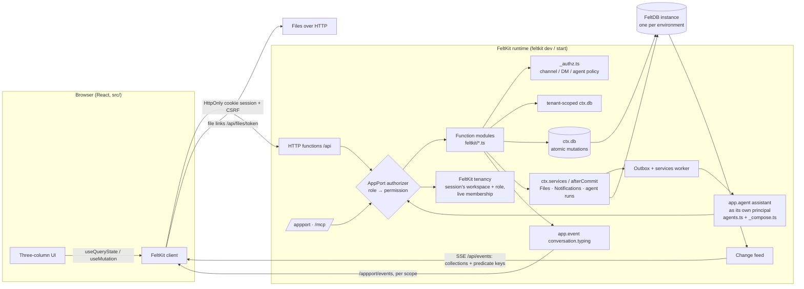

# Multiplayer architecture

## Components and boundaries

| Concern | Owner | In this app |
|---|---|---|
| Durable state | FeltDB (through `ctx.db`) | 10 collections, all but `participants` tenant-scoped; each mutation is one atomic transaction; reads are fenced at commit |
| Accounts, sessions | FeltKit `auth.accounts` | Password and e-mailed sign-in link/code, verification, reset, account settings; browser sessions are an HttpOnly cookie |
| Workspaces, memberships, roles, invitations, switching | FeltKit `auth.tenant` (`name: "workspace"`, roles owner > admin > member > guest > agent) | A workspace is a tenant. The session works in one; its role there is resolved from the live membership on every request and held as an ordinary role. Invitations by e-mail (single use, 7 days, revocable); agents and services added directly |
| Capability and permission boundary | AppPort, via FeltKit's authority | Accounts hold `person` (nothing in a workspace); workspace roles hold `channels.*`, `messages.*`, …, owner/admin also `tenant.*` / `tenant.members.manage`; the room agent `agent`; operators `operator` (Studio, credentials, jobs) |
| Workspace isolation | FeltKit tenant-scoped collections (`{ tenant: { field: "workspaceId" } }`) | `workspaceId` is stamped from the session; every read and write is filtered by it; another workspace's records do not exist for a call; a call with no workspace touches none |
| Resource authorization | FeltKit `feltkit({ authorize })` runs the **application's policy** (`feltkit/_authz.ts`) | A `workspaceId` argument must equal the session's workspace; minimum workspace roles; conversation policy (private channels, DMs, guests/agents), the agent run (`agent/assistant`: only its own requests) and typing subscriptions (`observe`) — on every interface, reads fenced at commit and tracked live |
| Files, notifications | AppPort Services on the same instance | Bytes and checksums in Files, uploaded and downloaded over FeltKit file links (`files.uploadLink` / `files.link`, issued only after the conversation is authorized; no base64 through functions); mention/agent notifications through `ctx.afterCommit` |
| Search | FeltKit `ctx.db.search` | `messages` declares `search: ["text"]`; one bounded search per conversation the caller can read |
| Real-time delivery | FeltKit change feed + client | Live queries re-run only when a write meets one of their equality predicates on declared fields (every read in the main queries is keyed: ids, references, indexes, the tenant field; a test checks a post in #random does not re-run #general) |
| Presence | Application (bounded records) | One overwritten `presence` record per participant per workspace: who is around must outlast the moment |
| Typing | FeltKit `app.event` + `useEvent` | `conversation.typing`, scoped to the conversation, never stored; observing it needs the right to read the conversation (`authorize`, kind `observe`) |
| Agent execution | FeltKit `app.agent` | `messages:send` records the request and calls `ctx.afterCommit.agent("assistant", { requestId })`; FeltKit's outbox runs it after the commit as the agent's principal (lease, retries with backoff, at-most-once writes), in the workspace only while the agent is a member there |
| Execution boundary | FeltKit's Node server | `feltkit dev` / `feltkit start`, or any `feltkit deploy` Node target. AppBoundry artifacts are not supported yet: AppBoundry hosts have no accounts or workspaces, and the AppBoundry build refuses `app.agent`, so `feltkit build --target appboundry` stops and says why |
| Identity | FeltKit sessions | Accounts (cookie sessions) for people; the agent's identity is declared by `app.agent` |

## Data model

| Collection | Kind | Key relations / constraints |
|---|---|---|
| `participants` | identity | unique `principalId`, unique `handle`; `kind` human or agent; `agentType` personal, workspace or application; `persona` for sample people (no principal) |
| *(FeltKit)* tenants, memberships, invitations | **authoritative** | FeltKit's own collections (`_feltkit_tenants`, `_feltkit_memberships`, `_feltkit_invitations`); invitation links carry an HMAC token that is never stored |
| `channels` | conversation | public, private, dm or group; unique (workspace, dmKey) for DMs/groups |
| `channelMembers` | **authoritative** | unique (channel, participant); `lastReadSeq` drives unread counts |
| `messages` | durable record | `seq` from `ctx.db.sequence("msg:<channel>")` (commit order, no gaps); `rootId` for threads; soft delete |
| `reactions` | durable record | unique (message, participant, emoji) |
| `attachments` | binding | fileId → channel. The Files service owns the bytes; this record authorizes reads |
| `presence` | ephemeral, bounded | unique (workspace, participant), overwritten |
| `agentRequests` | durable record | what was asked of the agent, by whom, and its state (pending → done or failed). The run itself (queue, lease, retries) is FeltKit's outbox |
| `sharedObjects` | durable work product | `project_plan` with tasks, decisions, risks, questions, cited message ids |
| `activity` | audit trail | meaningful changes only: joining, channels, agent actions, moderation. Role changes, removals and invitations are in FeltKit's auth activity |

There are no redundant copies. Unread counts, reply lists, reaction groups and presence state are all
derived when read. The one stored aggregate, `replyCount` on a thread root, is updated in the same
transaction as the reply.

## Authorization model

1. **Session and workspace (FeltKit).** An account signs in (cookie session in the browser, bearer for
   the agent). The session works in one workspace, chosen by the person (switching rotates the
   session); FeltKit resolves the live membership on every request, so a removed member's next call has
   no workspace and a changed role applies on the next call.
2. **Role (AppPort).** The workspace role (owner, admin, member, guest, agent) is held as an ordinary
   role only in that session: `channels.*`, `messages.*`, … for people, `agents.work`, `messages.read|write`,
   `plans.read|write`, … for the agent. An account alone holds `person` (no workspace permissions).
   Managing members and invitations needs `tenant.members.manage` (owner, admin), renaming
   `tenant.update` (owner); FeltKit lets a manager assign only roles below their own and always keeps
   an owner.
3. **Workspace isolation (FeltKit).** Workspace collections are tenant-scoped: ids from another
   workspace resolve to nothing (`NOT_FOUND`), and the workspace field cannot be set to another one.
4. **Conversation policy (application, enforced by FeltKit).** `authorize` in `feltkit/_authz.ts` runs
   after the role check and argument validation, before the handler, for every function (default deny):
   - A `workspaceId` argument (kept for compatibility) must be the session's workspace, else `NOT_FOUND`.
   - Role minimums: creating channels and reading activity need member; listing the agent and seeding
     the sample workspace need admin / owner.
   - Conversation: private channels, DMs and groups are readable by their members only. Public channels
     are readable by members, but not by guests or agents unless they were added.
   - Files: download links only through the attachment's conversation; upload links only to its members; a file is bound only by its uploader, to the conversation its link was issued for, once.
   - Agents: read only conversations a person brought them into, work only their own requests. They
     join a workspace only when an admin adds them (FeltKit: agents and services directly, people only by
     invitation). An agent mention never triggers another agent.

Client-supplied workspace ids, participant ids and roles are never trusted. The caller's participant
is always derived from the verified principal, the workspace and role from FeltKit's session.

The workspace directory (who can be mentioned, messaged, added to a channel, shown with presence) is
not stored by the application: it is FeltKit's current members (`ctx.tenancy.members()`) joined to
`participants` by principal id, plus the sample personas, who have no principal and are in a
workspace through its conversations. A removed member drops out of it at once: no mention, no
notification, no new DM. Membership changes reach FeltKit's change stream, so live queries and the
session re-run and a removed member's open page updates within a fraction of a second (≈0.2 s in the
e2e).

## Real-time and recovery

- Writes commit to FeltDB. FeltKit's change feed reads FeltDB's journal and streams changed collection
  names, with opaque keys for the changed records' keyed values, over SSE; a tenant-scoped collection's
  changes reach only subscribers in that workspace. Clients re-run the queries a change can affect
  through the authorized endpoint, so no data travels on the stream.
- A reconnecting client re-runs every query (`"*"`). A fresh page load reads everything from FeltDB.
  Durable state never depends on the delivery path. The e2e suite verifies both.
- Measured on the dev server: message delivery ≈100 ms, reaction ≈135 ms, unread badge ≈70–100 ms,
  typing ≈0.6 s (an event, throttled to one per 2.5 s while typing), agent round trip ≈0.2 s (e2e, the
  `app.agent` run started right after the commit), a removed member's open page ≈30 ms.
